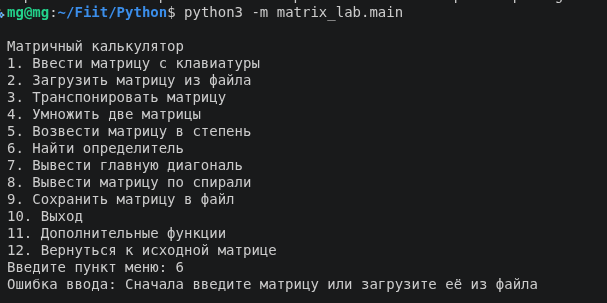
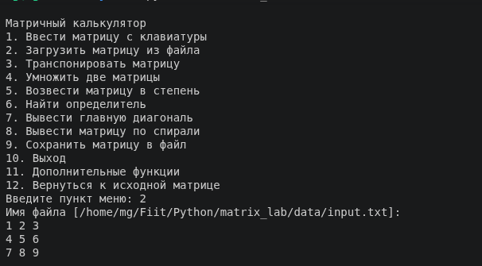
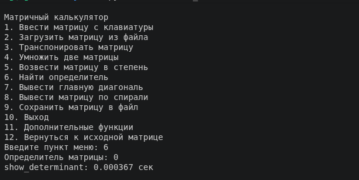
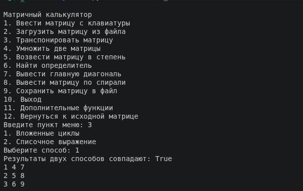
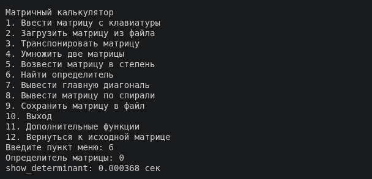
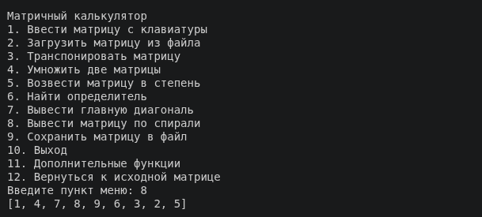
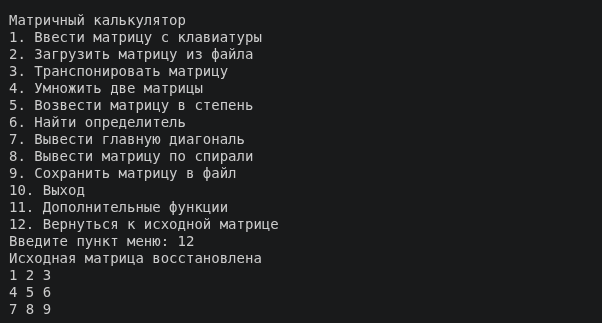
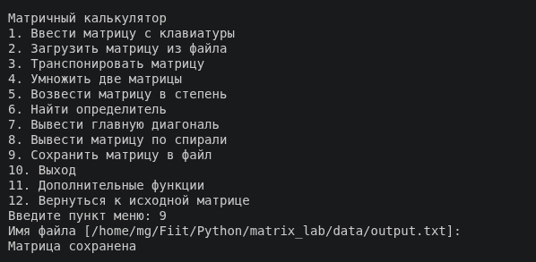
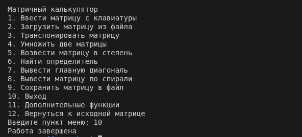

# Матричный калькулятор

Матрицы вводятся с клавиатуры или загружаются из текстовых файлов. Результаты вычислений можно вывести в консоль и сохранить в файл.

## Структура проекта

```text
matrix_lab/
├── __init__.py
├── main.py
├── matrix_ops.py
├── matrix_utils.py
├── matrix_io.py
├── decorators.py
├── README.md
├── screenshots/
└── data/
    ├── input.txt
    └── output.txt
```

`main.py` - главное меню (дополнительно к ТЗ добавились 11 пункт с доп.функциями и 12 пункт возврата к исходной матрице).

`matrix_ops.py` - математические операции над матрицами.

`matrix_utils.py` - ввод и вывод матриц, форматирование, вычисление статистики и поиск позиций минимального и максимального элементов.

`matrix_io.py` - генераторы для чтения матриц из файлов и обхода элементов матрицы.

`decorators.py` - декораторы для измерения времени выполнения функции и проверки квадратности матрицы.

Программа позволяет:

- вводить матрицу с клавиатуры и загружать её из файла;
- транспонировать матрицу двумя способами и сравнивать результаты;
- складывать и вычитать матрицы одинакового размера;
- умножать матрицы и умножать матрицу на число;
- вычислять определитель квадратной матрицы рекурсивным разложением по первой строке;
- создавать единичную матрицу и возводить квадратную матрицу в неотрицательную степень;
- при возведении в степень применять модуль;
- выводить элементы главной диагонали и обходить матрицу по спирали;
- получать статистику элементов и позиции минимума и максимума;
- применять заданную функцию к каждому элементу матрицы;
- просматривать счётчик вызовов матричных операций;
- сохранять текущую матрицу в файл и возвращаться к исходной матрице после вычислений.


## Реализованные темы

- коллекции: списки, кортежи, словари, множества;
- функции: позиционные и именованные аргументы, области видимости (`global`);
- функции высших порядков и лямбда-функции;
- вложенные циклы и списочные выражения;
- рекурсия;
- генераторы (`yield`);
- декораторы;
- файловый ввод/вывод (`with`) и потоковый ввод (`sys.stdin`);
- обработка исключений.


## Запуск программы

Откройте терминал в каталоге, в котором находится папка `matrix_lab`, и выполните команду:

```bash
python -m matrix_lab.main
```
или, если не сработает:

```bash
python3 -m matrix_lab.main
```

После запуска появится консольное меню.

## Формат входного файла

В первой строке файла указываются количество строк и количество столбцов. Затем записываются строки матрицы, построчно.

Пример содержимого `data/input.txt`:

```text
3 3
1 2 3
4 5 6
7 8 9
```
Для вещественных чисел используется точка.

По умолчанию при загрузке используется файл `data/input.txt`, а при сохранении результата - `data/output.txt`.

## Обработка ошибок

Программа проверяет размеры матриц перед выполнением операций. Если размеры несовместимы, матрица не квадратная для операции, введены некорректные данные или указанный файл не найден, пользователь получает сообщение об ошибке.

## Примеры проверки

В качестве начальных данных можно использовать матрицу из `data/input.txt`.

### Запуск и попытка операции без матрицы



### Загрузка матрицы из файла



### Определитель



### Транспонирование



### Определитель транспонированной матрицы



### Обход по спирали



### Возврат к исходной матрице



### Сохранение в файл



### Выход




